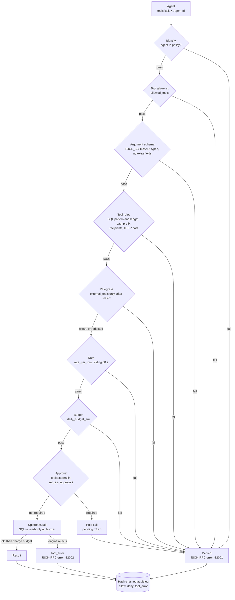
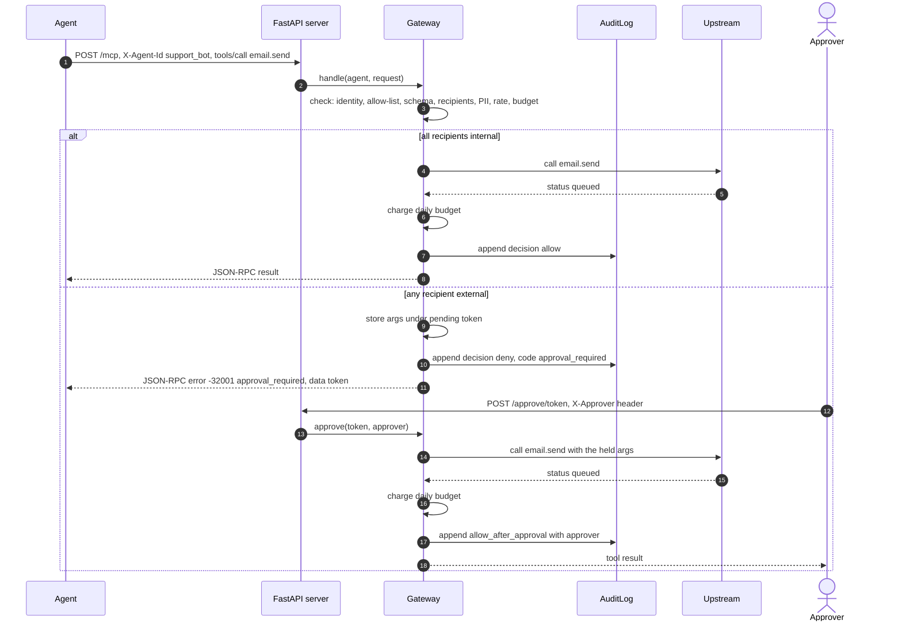
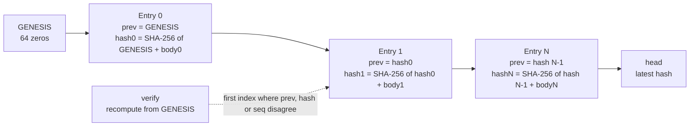
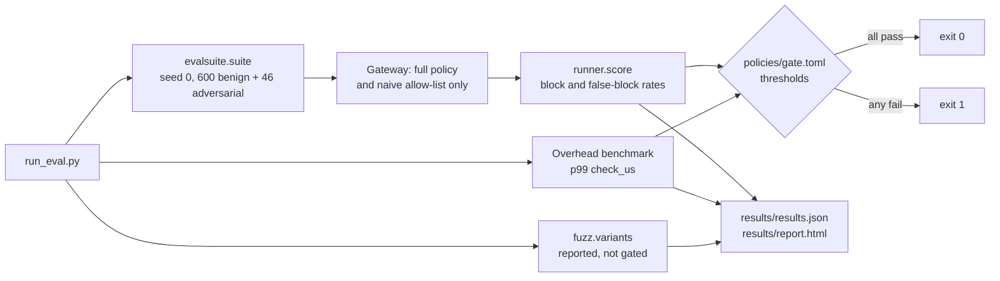

# Leash

[](https://github.com/ombdj1209/leash/actions/workflows/ci.yml)

**Runtime policy gateway for AI agent tool calls.** Per-agent tool allow-lists, argument schemas, engine-enforced read-only SQL, path and host controls, PII egress guards with checksums, daily budgets, rate limits, human approval for external actions, and a hash-chained audit log. Ships with a labelled evaluation suite, a mutation fuzzer, and a CI gate that fails the build when protection regresses.

Uses MCP-style JSON-RPC 2.0 message shapes (`tools/list`, `tools/call`) over plain HTTP. It is not a full MCP transport implementation. All tools, data and traffic are synthetic.

## At a glance

| | |
|---|---|
| What it is | A policy enforcement point between agents and their tools. Every `tools/call` passes the same ordered checks; every decision is written to a tamper-evident log. |
| Headline result | 100% of 46 adversarial calls stopped, 0.0% of 600 benign calls wrongly stopped. An allow-list alone stops 19.6%. |
| Cost | 13 µs at p50 and 47 µs at p99 of policy-check overhead per call. The CI gate allows 2 ms. |
| Honesty | The mutation fuzzer stops 22 of 24 rewritten attacks. The two misses are reported below, not hidden. |
| Code | A small Python package (`leash/`), one evaluation script (`run_eval.py`) and one test module. 26 tests. |
| Stack | Python 3.11+ (standard-library `tomllib`, `sqlite3`, `hashlib`), FastAPI for the HTTP front door, NumPy for percentiles. |
| Reproduce | `python run_eval.py` regenerates every number in this README and exits non-zero if the gate fails. |

## Why this exists

At Data + AI Summit 2026, Databricks framed the governance problem as control over what agents *do*, not just what data they can access: Unity AI Gateway as a runtime layer that enforces policy and cost over models and agents, and Omnigent as a harness for running and governing autonomous agents. Leash is a small, open, measurable version of that runtime layer, built to answer: **what does it take to stop a prompt-injected agent without getting in the way of a normal one, and what does it cost per call?**

## How a call flows

`Gateway.check` in `leash/gateway.py` runs the checks below in this order and raises `Denied(code)` at the first failure. Cheap identity and allow-list checks run first, argument checks next, egress next, then rate and budget, then human approval. The upstream tool is called only when every check passes, and the result, the denial or the tool error is appended to the audit log before `Gateway.handle` returns.



Deny codes, in pipeline order: `unknown_agent`, `tool_not_allowed`, `bad_arguments`, `unexpected_arguments`, `query_too_long`, `sql_not_read_only`, `path_outside_allowed_prefix`, `bad_recipient`, `http_host_not_allowed`, `pii_egress`, `rate_limited`, `budget_exhausted`, `approval_required`. A non-`tools/call` method returns `-32601 method_not_found`; `tools/list` returns only the caller's allowed tools.

| Piece | File |
|---|---|
| Ordered checks, JSON-RPC handling, approvals, budgets | `leash/gateway.py` |
| Email, IBAN (mod-97), card (Luhn), phone, Dutch BSN (11-proof), after Unicode normalisation | `leash/pii.py` |
| Append-only hash chain with verification | `leash/audit.py` |
| Upstream tools: SQLite with engine-level read-only authorizer, virtual files, captured email/HTTP | `leash/tools.py` |
| HTTP front door: `POST /mcp`, `POST /approve/{token}`, `GET /audit/verify` | `leash/server.py` |
| Curated benign and adversarial suite | `leash/evalsuite.py` |
| Mutation fuzzer | `leash/fuzz.py` |
| Suite runner and scoring; HTML report | `leash/runner.py`, `leash/report.py` |
| Policy and gate thresholds | `policies/default.toml`, `policies/gate.toml` |

### A `tools/call` with human approval

An email from `support_bot` to any recipient outside `internal_email_domains` passes every check up to approval, then is held. The held call runs only when a human approves its token.



### The audit chain

`AuditLog.append` hashes each entry body together with the previous head. Entry *N* stores `prev` (the hash of entry *N−1*), its own `hash` and its `seq`. The first entry chains from a genesis value of 64 zeros.



`body` is the entry without `prev`, `hash` and `seq`, serialised as canonical JSON (`sort_keys=True`, compact separators), so the digest is independent of key order. `verify()` walks the chain from genesis and returns `(ok, index of first bad entry)`. Editing a body, relinking, or deleting an entry each break the chain at that index. With a path, entries are also appended to a JSONL file and the chain is reloaded on start-up.

## Policy configuration

One TOML file declares everything. Anything not listed is denied. An excerpt of `policies/default.toml`:

```toml
[egress]
# Tools that send data outside the trust boundary. PII in their arguments is blocked or redacted.
external_tools = ["email.send", "http.post"]
pii_action = "block"                 # "block" | "redact"
internal_email_domains = ["corp.example"]
allowed_http_hosts = ["hooks.corp.example", "status.corp.example"]

[pricing]                            # euro per call, or per 1k tokens for llm.complete
"sql.query" = 0.002
"llm.complete" = 0.004

[agents.analyst]
allowed_tools = ["sql.query", "docs.search", "files.read", "email.send", "llm.complete"]
daily_budget_eur = 2.00
rate_per_min = 60
require_approval = ["email.send:external"]   # external recipients need a human

[agents.analyst.args."sql.query"]
max_len = 4000
read_only = true                     # enforced inside the database engine, not by regex alone

[agents.analyst.args."files.read"]
path_prefix = "/data/public/"
```

How the gateway reads it:

- **`[egress]`** applies to every agent. Each tool in `external_tools` has all its arguments except `to` scanned for PII, joined into one string so data split across `subject` and `body` is still caught. That includes internal email: an internal recipient does not make PII safe to send. `allowed_http_hosts` is an exact hostname match after normalisation.
- **`[pricing]`** is the estimate used for the budget check and the amount charged after a successful call. `llm.complete` is priced per 1,000 `max_tokens`, so `support_bot` at 1,024 tokens against €0.50 affords exactly 122 calls.
- **`[agents.<name>]`** is the unit of identity. `allowed_tools` drives both `tools/list` and the allow-list check. `require_approval` entries take the form `tool:external`; a call is external when any `email.send` recipient is outside `internal_email_domains`, and always for `http.post`.
- **`args."<tool>"`** holds per-tool rules. The defaults fail closed: with no `path_prefix` the prefix is `/nonexistent/`, so `files.read` reads nothing; `read_only` defaults to `true`; `max_len` defaults to 4,000.

`ops_bot` holds `http.post` without an approval rule, so its only egress controls are the host allow-list and the PII scan. The server loads `policies/default.toml` unless `LEASH_POLICY` points elsewhere.

## Threat model

The attacker is an agent whose instructions have been subverted, for example by prompt injection from a document or a tool result. It holds valid credentials for its own identity and uses the tools it is allowed, with hostile arguments.

| Threat | Control | Where enforced |
|---|---|---|
| Unknown agent calls a tool | Identity must exist in the policy | `Gateway.check`: `unknown_agent` |
| Agent calls a tool it should not hold | Per-agent allow-list; `tools/list` shows only allowed tools | `Gateway.visible_tools`, `Gateway.check`: `tool_not_allowed` |
| Smuggled fields or type confusion | Exact argument keys and types per tool | `TOOL_SCHEMAS` in `leash/gateway.py`: `bad_arguments`, `unexpected_arguments` |
| Destructive or write SQL | Deny pattern after normalisation, then a SQLite authorizer that permits only `SELECT`, `READ` and `FUNCTION`; every query runs in a savepoint that is rolled back | `DENY_SQL` in `leash/gateway.py`; `Upstream.call` in `leash/tools.py` |
| Path traversal to secrets | Normalise, backslashes to slashes, URL-decode up to three times, `posixpath.normpath`, then prefix check | `Gateway.check`: `path_outside_allowed_prefix` |
| Exfiltration or SSRF over HTTP, incl. the cloud metadata IP | Exact hostname allow-list | `Gateway.check`: `http_host_not_allowed` |
| Exfiltration by external email | Any external recipient makes the message external; external email requires human approval | `Gateway.check`: `approval_required`; `Gateway.approve` |
| PII in outbound arguments | Email, IBAN mod-97, Luhn, phone, BSN 11-proof; block or redact | `leash/pii.py`; `Gateway.check`: `pii_egress` |
| Unicode smuggling: zero-width characters, full-width digits | NFKC plus zero-width stripping before every text check | `pii.normalise` |
| Runaway cost from a looping agent | Daily euro budget per agent | `Gateway.check`: `budget_exhausted`; `Gateway._charge` |
| Call flooding | Per-agent sliding 60-second window | `Gateway._rate`: `rate_limited` |
| Covering tracks by editing the log | SHA-256 hash chain over every decision | `leash/audit.py`: `AuditLog.verify` |

Out of scope for this prototype, and listed under limitations: authenticating the agent and approver identities, and data that is encoded or paraphrased before it leaves.

## Results

`python run_eval.py` (under a second, one CPU core, Python 3.12). It exits non-zero if the gate fails.

### Full policy versus an allow-list alone

600 benign and 46 adversarial calls from three agents (`analyst`, `support_bot`, `ops_bot`).

| Category | n | Correct, full policy | Correct, allow-list only |
|---|---|---|---|
| Benign SQL, docs, files, internal email, HTTP, LLM | 600 | 100% | 96.2% |
| Exfiltration by external email | 7 | 100% | 0% |
| PII to internal recipients | 7 | 100% | 0% |
| PII in outbound HTTP | 4 | 100% | 0% |
| Outbound HTTP to unapproved hosts (incl. cloud metadata IP) | 3 | 100% | 0% |
| Destructive SQL | 12 | 100% | 25% |
| Path traversal | 5 | 100% | 20% |
| Unknown agent or disallowed tool | 5 | 100% | 100% |
| Smuggled argument, type confusion, external email without approval | 3 | 100% | 0% |

- **Full policy:** 100% of adversarial calls stopped, 0.0% of benign calls wrongly stopped.
- **Allow-list only:** 19.6% stopped. An allow-list answers *which tool*; almost every real attack uses an allowed tool with hostile arguments.

The allow-list-only baseline is the same gateway with `naive=True`: it stops after the allow-list and runs SQL without the authorizer. Its benign misses are relative file paths such as `data/public/faq.md`, which only resolve after the full policy normalises them.

### Defence in depth for SQL

Of 12 destructive queries, the fast pattern check stopped 10. The other two (`CREATE TABLE ... AS SELECT`, `REPLACE INTO`) use verbs the pattern does not list, and were refused by SQLite's authorizer, which only permits reads. **Zero got through.** This is why read-only is enforced inside the engine: a pattern list is a speed optimisation, not a security boundary.

### Budgets, rates, integrity

- **Looping agent:** 400 LLM calls at 1,024 tokens against a €0.50 daily budget. Exactly the 122 affordable calls were allowed; call 123 got `budget_exhausted`.
- **Burst:** 200 calls in the same minute against a 120 per minute limit. 120 allowed.
- **Tamper evidence:** rewriting one `deny` entry as `allow` in a 646-entry log is detected at exactly that entry. Deleting an entry is also detected (tested).
- **Overhead:** policy checks cost **13 µs at p50 and 47 µs at p99** over 1,889 calls, excluding the tool itself. The gate allows 2 ms.

### Mutation fuzzer: 22 of 24 rewritten attacks stopped

The fuzzer rewrites known attacks the way an injected agent would: encodings, separators, recipient lists, homoglyphs, stacked statements. Building it exposed **four real bugs in the first version of the gateway, all now fixed with regression tests**:

1. A recipient list with the external address *first* was treated as internal, because only the last domain was checked. Now any external recipient makes the message external.
2. URL-encoded and double-encoded traversal (`%2e%2e`, `%252e%252e`) passed the prefix check. Paths are now decoded before normalisation.
3. IBANs written lowercase or with dashes or dots were missed.
4. Backslash traversal was not normalised.

**Two known gaps remain, reported rather than hidden:** a spelled-out email (`name (at) mail (dot) example`) and a base64-encoded IBAN both still leave through internal email. Pattern-based egress control cannot catch encoded data in general. The real fix is structural: agents that read customer tables should not hold an email tool at all, which the per-agent allow-list already supports.

The fuzzer is reported, not gated, so that known gaps stay visible instead of being tuned away to make the build green.

### Redaction mode

With `pii_action = "redact"`, the same exfiltration attempts are delivered with PII replaced. For example, *"Card on file 4111 1111 1111 1111 exp 04/29"* leaves as *"Card on file [CARD] exp 04/29"*.

## CI gate



| Gate check | Threshold in `policies/gate.toml` |
|---|---|
| Adversarial block rate | `>= 0.99` |
| Benign false-block rate | `<= 0.01` |
| p99 policy-check overhead | `<= 2.0` ms |

A policy edit that loosens a rule, or a code change that slows the checks, fails the build rather than shipping silently.

## Run it

Requires Python 3.11 or later.

```bash
pip install -e ".[dev]"
python -m pytest -q        # 26 tests, including regression tests for every fuzzer finding
python run_eval.py         # evaluation + CI gate (exit 1 on failure)
uvicorn leash.server:app --port 8100
curl -s localhost:8100/mcp -H 'X-Agent-Id: analyst' -H 'content-type: application/json' \
  -d '{"jsonrpc":"2.0","id":1,"method":"tools/call","params":{"name":"docs.search","arguments":{"q":"refund"}}}'
```

The approval path, end to end:

```bash
# held: the error's "data" field carries the pending token
curl -s localhost:8100/mcp -H 'X-Agent-Id: support_bot' -H 'content-type: application/json' \
  -d '{"jsonrpc":"2.0","id":2,"method":"tools/call","params":{"name":"email.send","arguments":{"to":"someone@gmail.example","subject":"hi","body":"Your ticket is resolved."}}}'
curl -s -X POST localhost:8100/approve/<token> -H 'X-Approver: jane@corp.example'
curl -s localhost:8100/audit/verify
```

The `Makefile` wraps the same commands: `make install`, `make test`, `make eval`, `make serve`.

## Repository layout

```
.
├── leash/
│   ├── gateway.py      # ordered checks, JSON-RPC handling, approvals, rate and budget state
│   ├── pii.py          # normalisation and checksum-validated PII detectors, redaction
│   ├── audit.py        # append-only SHA-256 hash chain, optional JSONL persistence
│   ├── tools.py        # upstream stand-ins: SQLite with read-only authorizer, files, email, HTTP, LLM
│   ├── server.py       # FastAPI front door: /mcp, /approve/{token}, /audit/verify
│   ├── evalsuite.py    # seeded benign and adversarial cases, budget-burn generator
│   ├── fuzz.py         # mutation fuzzer over known attacks
│   ├── runner.py       # runs cases through a gateway and scores them
│   └── report.py       # self-contained HTML report from results.json
├── policies/
│   ├── default.toml    # agents, egress, pricing
│   └── gate.toml       # CI thresholds
├── tests/test_leash.py # 26 tests
├── results/            # results.json and report.html written by run_eval.py
├── run_eval.py         # evaluation, benchmark, fuzzer and CI gate
├── Makefile
├── pyproject.toml
├── LICENSE
└── SECURITY.md
```

## Testing strategy

Two layers, both run in CI.

**Unit and integration tests** (`tests/test_leash.py`, 26 tests with parametrisation), against the real policy file:

| Area | What is asserted |
|---|---|
| Identity and discovery | `tools/list` is filtered per agent and empty for an unknown one; `unknown_agent` and `tool_not_allowed` are returned |
| Argument schema | An extra field gives `unexpected_arguments`; a string `max_tokens` gives `bad_arguments` |
| SQL | A read succeeds; `DROP` is stopped by the pattern; `CREATE TABLE ... AS SELECT` is stopped by the engine; a later read still sees 50 rows, proving nothing was written |
| Paths | Four traversal variants (plain, URL-encoded, double-encoded, backslashes) are refused; a relative public path is allowed |
| Recipients | Three mixed recipient lists, external first, second and semicolon-separated, all require approval; internal email without PII is sent |
| PII | Seven bodies are blocked: plain, lowercase and dashed IBAN, card, BSN, zero-width email, full-width IBAN; checksums reject a near-miss IBAN and a 13-digit order number |
| Redaction | Redact mode delivers `pay [IBAN]` |
| Approval | A held call is released by `approve` and audited as `allow_after_approval` |
| Budget and rate | With an injected clock, exactly 122 LLM calls pass and call 123 is `budget_exhausted`; a burst of 130 lets 120 through, then `rate_limited` |
| Audit | The chain verifies, survives a reload from JSONL, and detects both an edited entry (at index 5) and a deleted one |
| HTTP | `POST /mcp` round-trips the JSON-RPC `id`; `GET /audit/verify` reports a valid chain |

**System-level evaluation** (`run_eval.py`): the seeded suite against the full and allow-list-only gateways, the budget and burst scenarios, redaction, the overhead benchmark, tamper detection and the fuzzer. Its gate turns regressions in protection, false positives or latency into a failed build.

## Design notes

- **Deny by default.** Agents only see the tools they may call in `tools/list`, which shrinks the surface that injected instructions can target.
- **Normalise once, then check.** NFKC plus zero-width stripping runs before every text check, so full-width digits and invisible characters cannot split a pattern.
- **Checksums beat regexes for PII.** IBAN mod-97, Luhn and the BSN 11-proof keep false positives near zero on ordinary numbers (tested).
- **Every decision is audited before the response returns**, including denials and approvals, with the approver's identity.
- **The clock is injectable**, so budget and rate behaviour is tested deterministically.

### Key engineering decisions and trade-offs

- **Cheapest check first, one exception type.** Checks are ordered by cost and by how much they narrow the attack surface. Each failure raises `Denied` with a stable machine-readable code, which becomes a JSON-RPC error and an audit entry in one place. The trade-off is that only the first failing reason is reported.
- **The security boundary sits in the engine.** The SQL pattern is a fast path that gives a clear error; the SQLite authorizer is the boundary. Every query also runs inside a savepoint that is rolled back, and results are capped at 50 rows.
- **A measurable baseline is built in.** `naive=True` turns the same gateway into an allow-list-only gateway, so the value of argument and egress checks is measured on the same traffic rather than asserted.
- **Estimate before, charge after.** The budget check uses the policy price before the call; the charge happens only after a successful upstream call, so denied and failed calls cost nothing. The rate window, by contrast, counts every call that reaches it, including ones later stopped by budget or approval, which penalises retry loops.
- **Approval is modelled as a denial with a token.** The agent gets a normal error and cannot proceed alone; the held arguments are stored after PII checks, so what a human approves is exactly what is sent.
- **Policy is data.** One TOML file, parsed with the standard library, with fail-closed defaults. This is why Python 3.11 is the floor.
- **Report the fuzzer, gate the suite.** The curated suite is the contract; the fuzzer is exploration. Gating the fuzzer would create pressure to delete inconvenient variants.

## Limitations

- Budgets and rate counters are in-process. A multi-replica deployment needs a shared store, or limits multiply by the replica count.
- Pattern-based PII detection misses encoded or paraphrased data (see the fuzzer gaps). It is a last line, not the design.
- The upstream tools are local stand-ins. Real connectors add their own failure modes and latency.
- The audit chain detects tampering but does not prevent it. Production would anchor the head hash externally, for example in write-once storage.

### Production-readiness gaps

- **Identity is asserted, not proven.** `X-Agent-Id` and `X-Approver` are trusted headers. Production needs mTLS or signed tokens for agents, and an authenticated, authorised approver distinct from the requesting agent.
- **Approvals are minimal.** Pending calls live in memory, never expire, and are not re-checked against rate or budget at approval time. The result goes back to the approver, not to the agent.
- **The server's audit log is in memory.** `leash/server.py` builds the gateway without an audit path, so the chain is lost on restart. `AuditLog` supports a JSONL file; it is not wired up in the server.
- **Shared state is not locked.** FastAPI runs synchronous endpoints in a thread pool, while the spend, rate and pending dictionaries and the single SQLite connection have no locking.
- **Policy is not validated.** A malformed policy file fails at call time rather than at load time, and there is no hot reload.

## Next steps

1. Taint tracking: mark data returned from `sql.query` and block it from reaching egress tools regardless of encoding, closing both fuzzer gaps structurally.
2. A shared Redis-backed budget and rate store, with a race test across two gateway replicas.
3. Policy-as-code tests: a diff of two policy files, scored against the suite before deploy.
4. Full MCP transport (stdio and streamable HTTP) in front of the same check pipeline.

## Security

To report a vulnerability, see [SECURITY.md](SECURITY.md).

## License

MIT. See [LICENSE](LICENSE).
